

  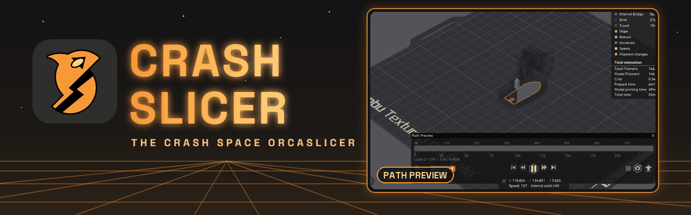

  
  
  
  
  
  

  <a href="#whats-new-in-24">What's new</a> ·
  <a href="#the-features">Features</a> ·
  <a href="#see-it-in-action">See it in action</a> ·
  <a href="#path-preview-player">Path preview</a> ·
  <a href="#part-stacking">Part stacking</a> ·
  <a href="#print-version-control">Version control</a> ·
  <a href="#animated-print-status">Print status</a> ·
  <a href="#all-in-preferences">Preferences</a> ·
  <a href="#coming-next-transform-copy-and-paste">Coming next</a> ·
  <a href="#download">Download</a> ·
  <a href="#building">Building</a> ·
  <a href="#roadmap">Roadmap</a>

<table>
<tr>
<td width="48%">
  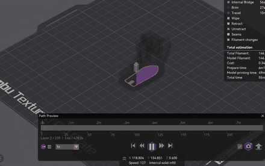
</td>
<td>

###  OrcaSlicer, with the features CRASH Space wanted

CrashSlicer is a fork of [OrcaSlicer](https://github.com/OrcaSlicer/OrcaSlicer) built for
[CRASH Space](https://blog.crashspace.org), the Los Angeles hackerspace. It bundles the
features I've been building for the slicer into one ready-to-run build, so members (and
anyone else) can use them without waiting for each one to land upstream.

Play back a toolpath like a video, drag objects along two axes at once, snap copies into
place, star the settings you always touch, and watch your printer's status animate.
Everything else is the OrcaSlicer you already know: same profiles, same printers.

It ships with a CRASH Space theme and icon, and community default profiles.

</td>
</tr>
</table>

> [!NOTE]
> CrashSlicer is a beta and isn't affiliated with the OrcaSlicer team. Features marked
> *In review* are being tidied up to offer upstream; *In progress* ones are new in 2.4
> and still changing. Found a bug? [Open an issue](https://github.com/Theo-Erickson/CrashSlicer/issues).

## What's new in 2.4

| | |
|---|---|
| **Path preview player** | Play, pause, scrub and step the toolpath preview, with an orbiting camera and a beta animation export |
| **Dual axis move and scale** | Plane handles move or scale an object along two axes while the third stays put |
| **Plate position snapping** | Snap to the plate's center, center lines and edges, with guides while you drag |
| **Quick position shift ticks** | Ticks at 1x, 2x and 3x an object's size, for lining up copies |
| **User model library** | Add your go-to parts (holders, brackets, adapters) from a right-click menu |
| **Animated splash screen** | 9 animated themes, from Circuit to Techs-alotl |
| **Part stacking** (alpha) | Stack copies in Z with generated blockers and supports to fit more on a plate |
| **3 new print states** | Bed leveling, Error pause and Heating join the animated print status icons |

## The features

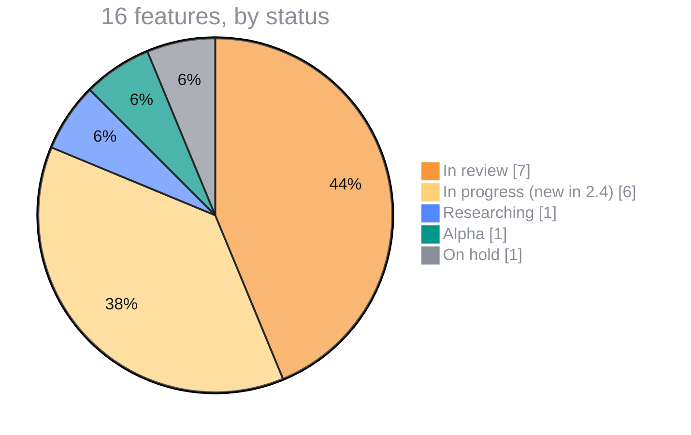

| Feature | What it does | Status |
|---|---|---|
| **Path preview player** | A floating playback bar for the toolpath preview: play, pause, scrub, step by layer or by move, speed, camera motion, and a beta animation export | In progress |
| **Dual axis move and scale** | Colored plane handles (red YZ, green XZ, blue XY) move or scale across two axes while the third stays locked. Has its own Preferences page | In progress |
| **Plate position snapping** | Snap objects to the plate's center, its center X or Y line, or its edges, with guides while dragging. Each target can be switched off | In progress |
| **Quick position shift ticks** | Gray ticks at 1x, 2x and 3x an object's bounding box, for lining up copies. The snap distance is a setting | In progress |
| **User model library** | A right-click menu that adds models from a folder you choose | In progress |
| **Animated splash screen** | 9 animated splash themes, plus the classic splash and *Match print status theme* | In progress |
| **Part stacking** | Stacks copies along Z with generated blockers and supports. Trades some surface quality and risk for a fuller plate | Alpha |
| **Favorites panel** | Star any process setting to pin it to a Favorites tab, grouped by category, with jump-to links | In review |
| **Alt unit display** | Hold <kbd>Alt</kbd> to see sizes in the other unit system, and add a key to make the switch stick ([how it works](#alt-unit-display)). Upstream as [OrcaSlicer#13168](https://github.com/OrcaSlicer/OrcaSlicer/pull/13168) | In review |
| **Slice settings history** | Saves a settings snapshot on every slice, so you can browse, diff and restore them, with per-extruder filament breakdowns | In review |
| **Animated print status** | Looping animated icons for 15 printer states, in 12 themes | In review |
| **Animated tab icons** | Hover, press, ripple and fill animations on the top tabs | In review |
| **Transform tool cycling** | <kbd>Space</kbd> and <kbd>Shift</kbd>+<kbd>Space</kbd> cycle Move, Rotate and Scale | In review |
| **Local version control** | A History tab that keeps 3MF snapshots of each project you can roll back to ([more](#print-version-control)) | In review |
| **New infill patterns** | Experimental fills for strength-to-weight and flexible filaments | Researching |
| **UI color settings** | Pick the interface's accent color, with light and dark variants | On hold |

Every feature has its own settings in Preferences ([see which](#all-in-preferences)), and
**Transform copy and paste** is [coming next](#coming-next-transform-copy-and-paste).

The full write-up, with every feature's screenshots and changelog, is on the
[CRASH Space blog](https://blog.crashspace.org/facilities/orca-slicer-fork-feature-development-future-downloads-page/).

## See it in action

Every clip is the real app, recorded while building each feature.

<table>
<tr>
<td align="center">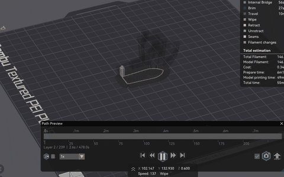 <b>Path preview</b>: play the toolpath back</td>
<td align="center">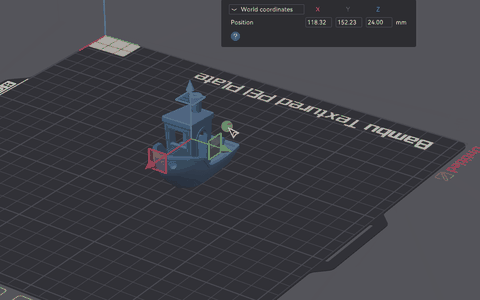 <b>Dual axis</b>: drag on a plane, not a line</td>
</tr>
<tr>
<td align="center">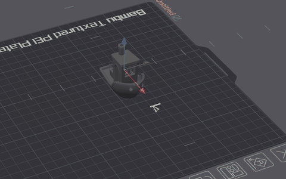 <b>Snap ticks</b>: line copies up one size apart</td>
<td align="center">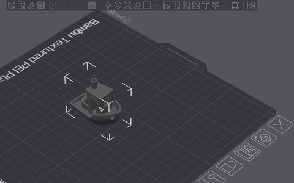 <b>Plate snapping</b>: center, center lines and edges</td>
</tr>
<tr>
<td align="center">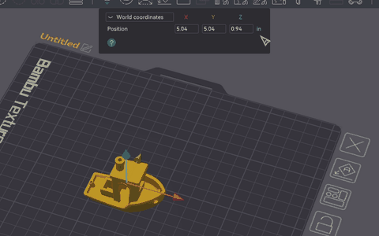 <b>Unit swap</b>: mm and inches, one key away</td>
<td align="center">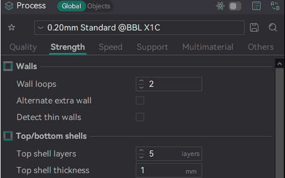 <b>Favorites</b>: star the settings you always change</td>
</tr>
</table>

   
  The animated tab icons.

  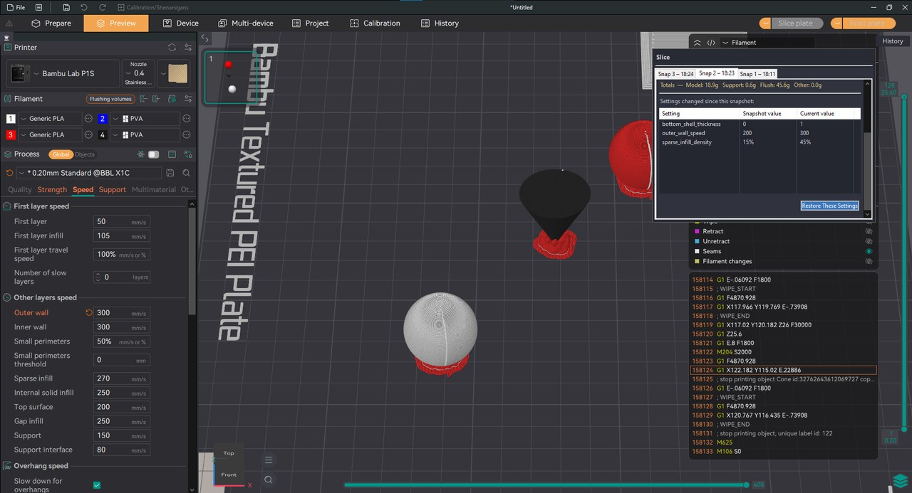 
  Slice settings history: every slice keeps its settings, so you can diff two and restore either.

<table>
<tr>
<td align="center" width="50%">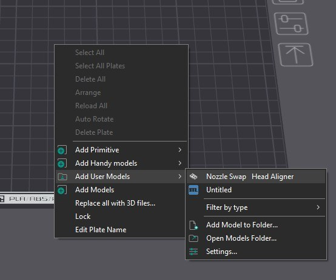 The user model library</td>
<td align="center" width="50%">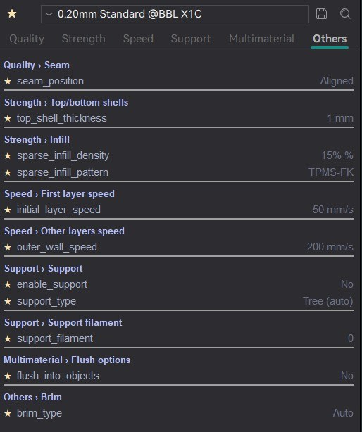 The Favorites tab</td>
</tr>
</table>

## Path preview player

Slice, open **Preview**, and click the player button in the corner of the view
(right-click it to move it or change its look).

  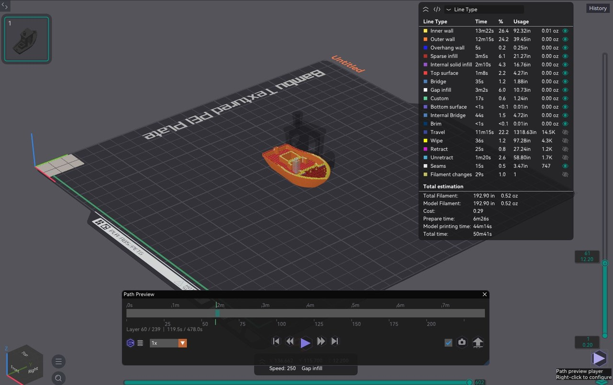

| | |
|---|---|
| **Modes** | *XY path* draws every move in a layer before the next; *Layers* builds up one layer at a time |
| **Speed** | 0.125x to 8x, or a custom speed |
| **Transport** | First and last layer, step back and forward, play and pause, and a scrubber over the whole print |
| **Camera** | Orbit (horizontal rotation), pitch (vertical tilt) and rise (Z tracking), each with its own speed, optionally scaled with the playback rate |
| **Export** (beta) | PNG sequence, animated GIF, MP4 (with FFmpeg) or a screen recording, with resolution presets, a watermark and a print-info overlay |

<b>The export dialog</b>

  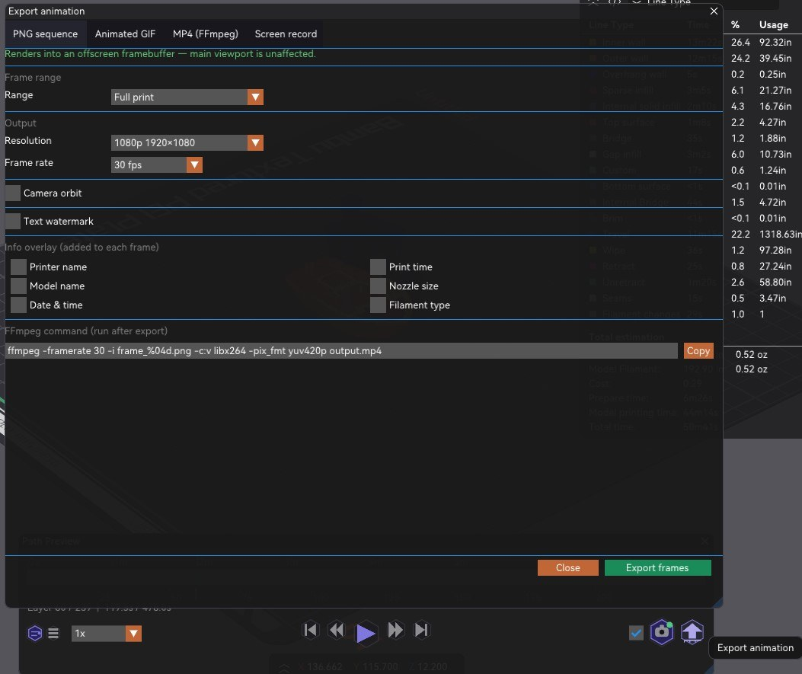

Exports render frames as fast as the GPU allows rather than in real time. While one runs,
the main view is busy, so let it finish before you keep working.

## Alt unit display

Millimeters or inches, without opening Preferences:

| Do this | What happens |
|---|---|
| **Hold** <kbd>Alt</kbd> | Every size and position switches to the other unit system while you hold it, and the unit label glows light blue to show it's temporary. Let go and it switches back |
| **Hold** <kbd>Alt</kbd>, **then press** <kbd>U</kbd> | The switch sticks: it's saved as your **Units** setting in Preferences, so it's still there when you let go and next time you open the app |

> [!NOTE]
> That's the key in this build. In the version offered upstream
> ([OrcaSlicer#13168](https://github.com/OrcaSlicer/OrcaSlicer/pull/13168), branch
> `AltUnitDisplayImprovements`) the switch sticks with <kbd>Shift</kbd> instead: hold
> <kbd>Alt</kbd>, press <kbd>Shift</kbd>.

<table>
<tr>
<td align="center" width="50%">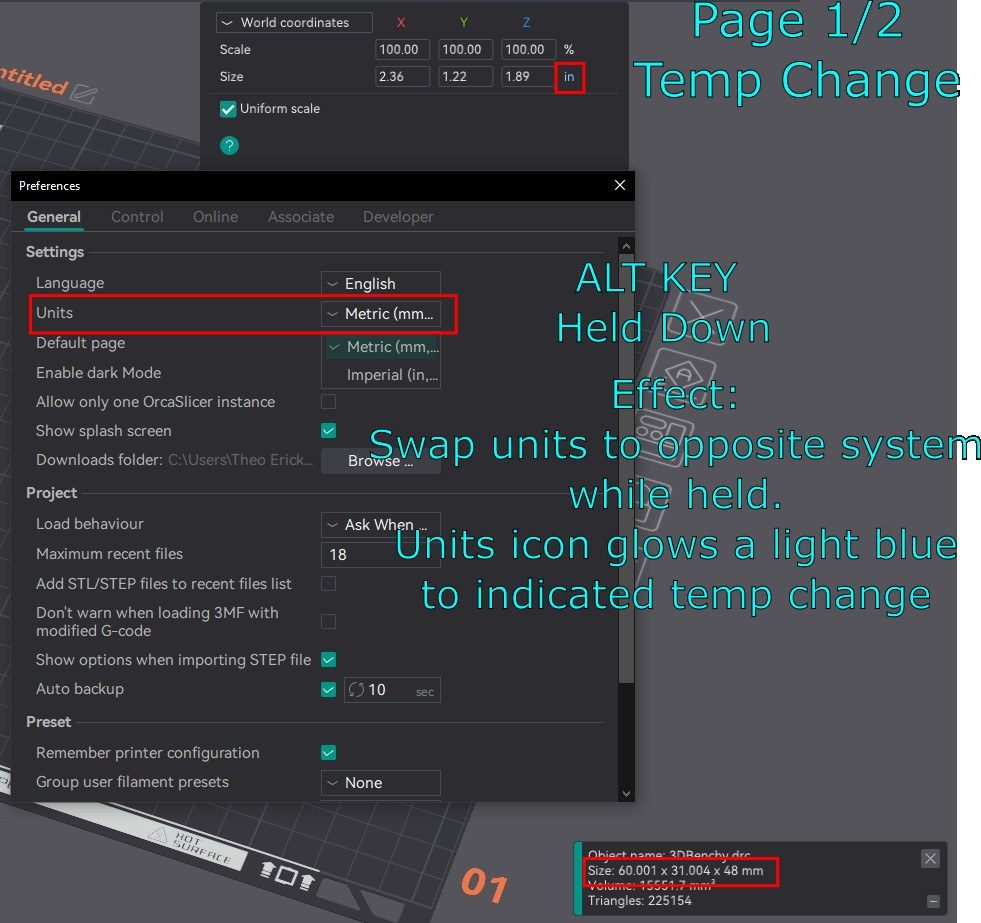 Holding <kbd>Alt</kbd>: inches for now, Preferences still says Metric</td>
<td align="center" width="50%">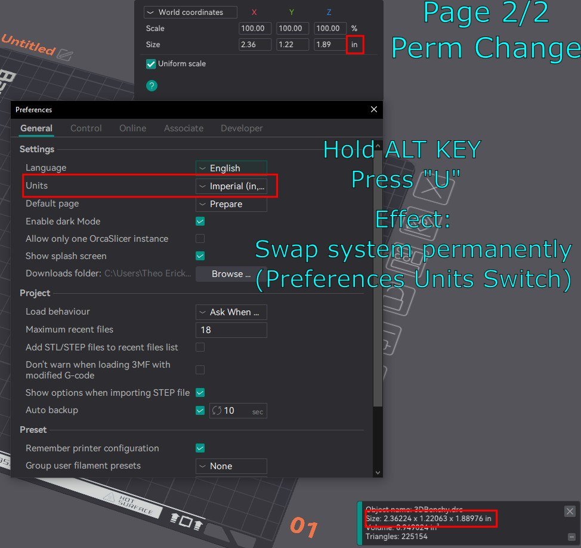 Adding <kbd>U</kbd>: the Units preference itself switches</td>
</tr>
</table>

## Part stacking

Right-click an object and choose **Stack Objects** to print copies on top of each other.
CrashSlicer puts a thin separator disc between each copy and fills a breakaway gap above
each disc with support interface material, so every copy peels off on its own once it's
printed. Tree supports hold the discs up between objects.

<table>
<tr>
<td align="center" width="50%">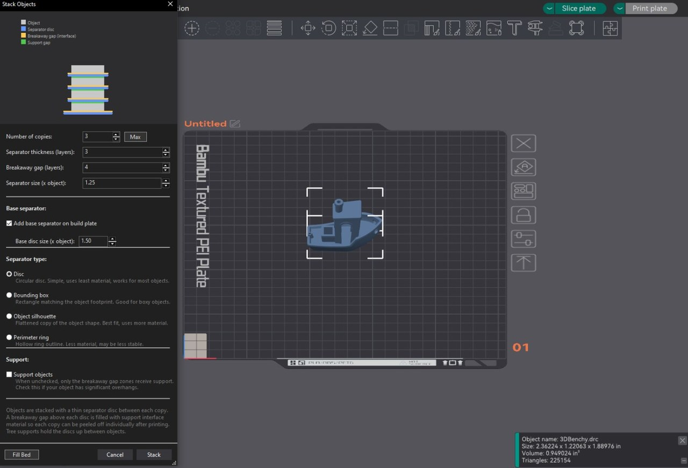 The Stack Objects dialog</td>
<td align="center" width="50%">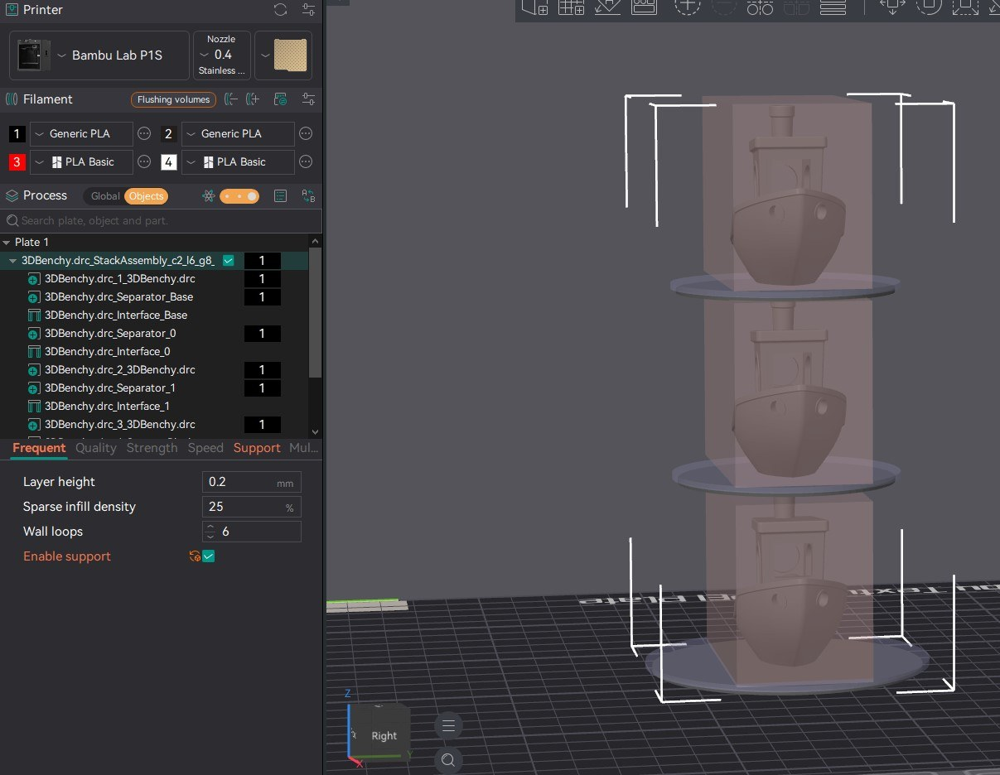 Three copies, one stack assembly</td>
</tr>
<tr>
<td align="center">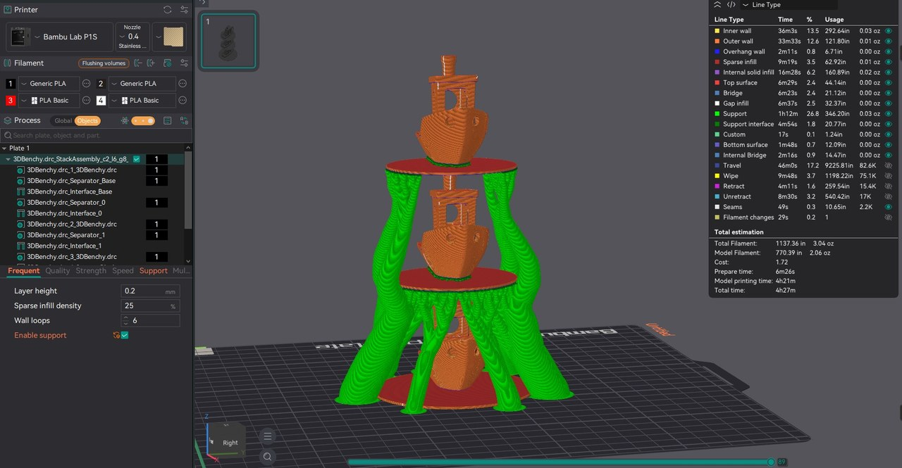 Sliced</td>
<td align="center">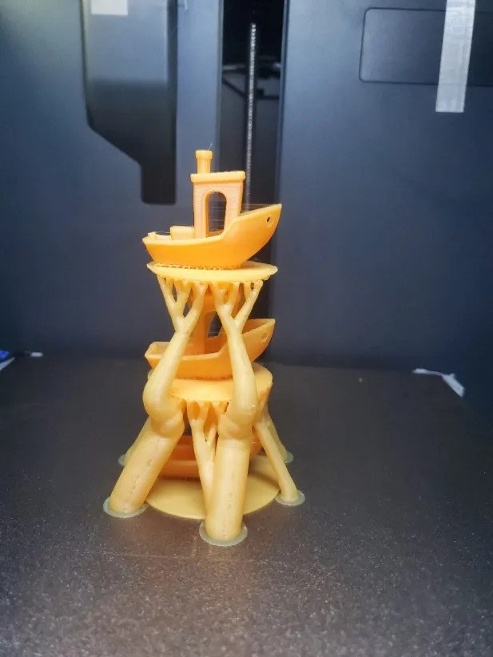 And off a Bambu Lab P1S</td>
</tr>
</table>

| Setting | What it sets |
|---|---|
| **Number of copies** | How many to stack. **Max** fits as many as the printer's height allows, and **Fill Bed** repeats the stack across the plate |
| **Separator thickness** | The disc between copies, in layers |
| **Breakaway gap** | The support interface layers above each disc that let a copy peel off |
| **Separator size** | How far the disc reaches past the object, as a multiple of its size |
| **Base separator** | An optional wider disc on the build plate, with its own size |
| **Separator type** | **Disc** (simple, least material) · **Bounding box** (for boxy objects) · **Object silhouette** (a flattened copy of the shape: best fit, more material) · **Perimeter ring** (least material, less stable) |
| **Support objects** | Off: only the breakaway gaps get support. On: the objects themselves too, for big overhangs |

> [!WARNING]
> Part stacking is an alpha. Stacked copies trade some surface quality on their
> undersides, and a failure partway up costs every copy above it.

## Print version control

The **History** tab keeps every project you've opened, with its path and when you last
used it, under **Projects** and **G-code Files**. Pick one and its **VCBackups** are listed
underneath: 3MF snapshots taken as you work, with when each was saved.

<table>
<tr>
<td align="center" width="40%">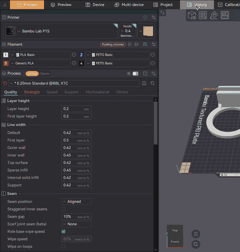 Browsing a project's backups</td>
<td>

- **VCBackup now** takes a snapshot on the spot.
- **Restore this VCBackup** opens a snapshot; **Delete VCBackup** and **Delete all
  VCBackups** tidy up.
- **Open Folder** shows the project on disk, and **Remove Entry** or **Clear All** trims
  the list.
- Coming: a **Backup Storage Location** menu, to move the backup folder somewhere else.

</td>
</tr>
</table>

  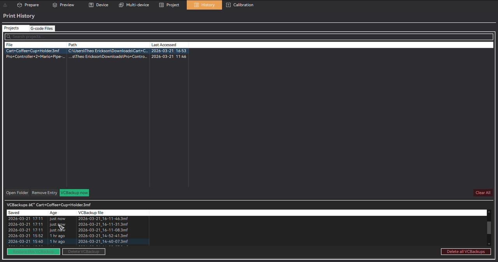

## Animated print status

The slicing and printing status in the corner animates, in the theme of your choice.
These are the theme files themselves, from
[`resources/images/print_status/gifs/themes/`](resources/images/print_status/gifs/themes):

| Theme | Slicing | Printing | Finished | Failed |
|---|:-:|:-:|:-:|:-:|
| **Circuit** |  |  |  |  |
| **Synthwave** |  |  |  |  |
| **Deep Sea** |  |  |  |  |
| **Retro Gaming** |  |  |  |  |
| **Fantasy** |  |  |  |  |
| **Techs-alotl** |  |  |  |  |
| **Splatter** |  |  |  |  |
| **Bambu** |  |  |  |  |
| **Prusa** |  |  |  |  |

Each theme covers 15 states: idle, slicing, sliced, sending, preparing, heating, bed
leveling, calibrating, printing, filament change, paused, error pause, finished, failed and
offline. Pick one under **Print Status Customization** in Preferences, which also sets the splash screen when
it's on *Match print status theme*.

<b>The 9 splash themes</b>

Circuit · Makerspace · CRASH Space · Synthwave · Cyberpunk · Deep Sea · Retro Gaming ·
Fantasy · Techs-alotl. Choose one in Preferences, where a live preview plays it; the choice
is saved as `app/splash_theme`.

## All in Preferences

Every feature can be tuned or switched off. Most live on two new Preferences tabs, and
the rest are set where you use them:

| Where | Section | Features |
|---|---|---|
| **General** | Units | Metric or Imperial, the same setting <kbd>Alt</kbd>+<kbd>U</kbd> changes |
| **Customization** | Tab Icons | The animated tab icons |
| | Splash Screen | Which splash theme plays, with a live preview |
| | Print Status Customization | The print status theme, and its icons |
| **Gizmo** | Plane Handles | Dual axis handles: position, shape, size and drag plane opacity |
| | Snap Ticks | Axis ticks (display, start multiplier, increment, tick count, opacity), which axes get them, and plate ticks (display, divisions, opacity, which edges) |
| Path preview player | Right-click its button · Camera motion | Where the player sits and how it looks · orbit, pitch and rise |
| Right-click menu | Quick Add: User Model Menu | The model folder and which file types show |
| Stack Objects dialog | | Every stacking setting, per stack |

  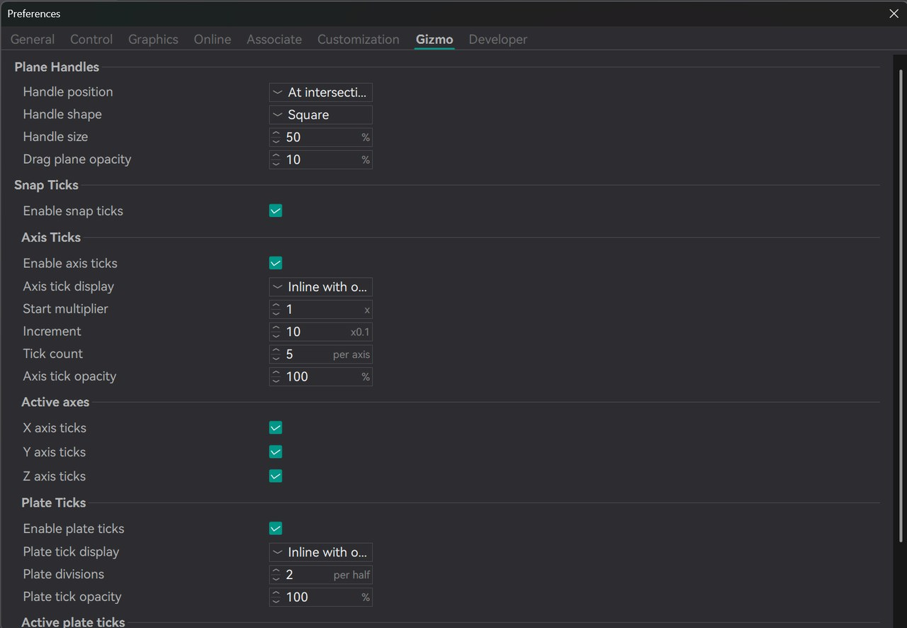 
  The Gizmo tab: plane handles and snap ticks.

<b>More of the settings</b>

<table>
<tr>
<td align="center" width="50%">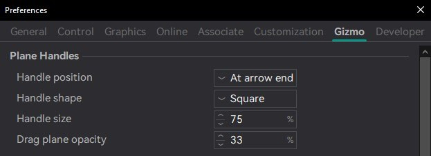 Dual axis plane handles</td>
<td align="center" width="50%">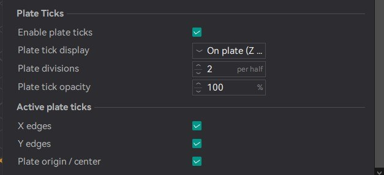 Plate snap targets</td>
</tr>
<tr>
<td align="center" colspan="2">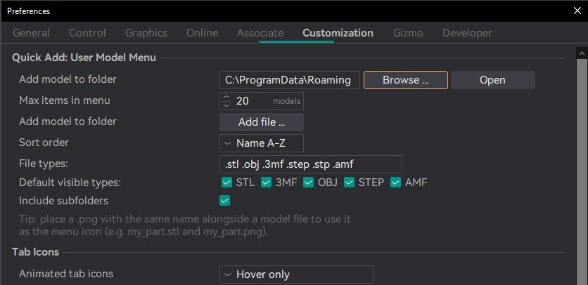 The user model library's folder and file types</td>
</tr>
</table>

## Coming next: transform copy and paste

Copy one object's transform and paste it onto another: all of it, or just its position,
rotation, scale, size or mirroring, on the axes you pick.

<table>
<tr>
<td align="center" width="50%">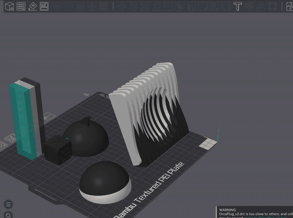 A prototype: one part's transform pasted onto another</td>
<td>

The **Transform clipboard** sits in the Move panel:

- **Whole transform**: <b>Copy</b> and <b>Paste</b>.
- **Position, Rotation, Scale %, Size and Mirror**: a <b>C</b> and <b>P</b> for each, to
  move just that one.
- **Axes**: X, Y and Z toggles, so a paste can change only some of them.
- It shows what it's holding (an instance or a part) and the values.

It's on the `TransformCopyOptionsFeature` branch and not in the 2.4 beta yet.

</td>
</tr>
</table>

## Download

The 2.4 beta is a [pre-release on GitHub](https://github.com/Theo-Erickson/CrashSlicer/releases/tag/Beta).
Each download is a zip:

| System | Download | Size |
|---|---|---|
| Windows | [Installer](https://github.com/Theo-Erickson/CrashSlicer/releases/download/Beta/OrcaSlicer_Windows_V2.4.0-dev.1.zip) · [Portable](https://github.com/Theo-Erickson/CrashSlicer/releases/download/Beta/OrcaSlicer_Windows_V2.4.0-dev_portable.zip) | 130 MB · 165 MB |
| macOS (universal) | [DMG](https://github.com/Theo-Erickson/CrashSlicer/releases/download/Beta/OrcaSlicer_Mac_universal_V2.4.0-dev.1.zip) | 207 MB |
| Linux (Ubuntu 24.04) | [AppImage](https://github.com/Theo-Erickson/CrashSlicer/releases/download/Beta/OrcaSlicer_Linux_ubuntu_2404_V2.4.0-dev.1.zip) | 131 MB |
| Linux Flatpak | [x86_64](https://github.com/Theo-Erickson/CrashSlicer/releases/download/Beta/OrcaSlicer-Linux-flatpak_V2.4.0-dev_x86_64.flatpak.1.zip) · [ARM64](https://github.com/Theo-Erickson/CrashSlicer/releases/download/Beta/OrcaSlicer-Linux-flatpak_V2.4.0-dev_aarch64.flatpak.1.zip) | 125 MB · 120 MB |

> [!TIP]
> CrashSlicer installs as **OrcaSlicer** and reads the same profiles folder, so your
> printers, filaments and processes carry over. Back up your OrcaSlicer folder first if
> you want to be able to go back.

<b>First launch</b>

The builds aren't code-signed, so:

- **Windows:** SmartScreen may say "Windows protected your PC". Click **More info → Run anyway**.
- **macOS:** right-click the app and choose **Open** the first time, or run
  `xattr -dr com.apple.quarantine /Applications/OrcaSlicer.app`.

## Building

CrashSlicer builds exactly like OrcaSlicer, from the `CrashSlicer-main` branch:

| On | Run |
|---|---|
| Windows | `build_release_vs2022.bat` |
| macOS | `./build_release_macos.sh` |
| Linux | `./build_linux.sh -dsi` |

The [OrcaSlicer build guide](https://www.orcaslicer.com/wiki) has the prerequisites for each.

<b>Where each feature lives</b>

Each feature started on its own branch, then merged into `CrashSlicer-main`:

| Feature | Branch | Code |
|---|---|---|
| Path preview player | `SlicePathPreviewTimelineFeature` | `src/slic3r/GUI/PathPreview*` |
| Dual axis, snap ticks | `DualAxisMoveAndScaleFeature` | |
| Part stacking | `PartStackingFeature` | |
| User model library | `RightClickMenuFrequentAddModelsFeature` | |
| Animated splash screen | `CustomSplashScreenFeature` | `src/slic3r/GUI/Splash/` |
| Favorites panel | `FavoritesTab` | `src/slic3r/GUI/Favorites*` |
| Alt unit display | `AltUnitDisplayImprovements` | |
| Slice settings history | `SliceHistory` | `src/slic3r/GUI/SliceHistory*` |
| Animated print status | `AnimatedPrintStatus` | `src/slic3r/GUI/PrintStatus*` |
| Animated tab icons | `AnimatedTabIcons` | `resources/images/tab_icon_gifs/` |
| Transform tool cycling | `TransformToolCyclingFeature` | |
| Transform copy and paste (next) | `TransformCopyOptionsFeature` | |
| Local version control | | `src/slic3r/GUI/HistoryPanel*`, `ProjectVCBackupManager*` |
| New infill patterns | `NewInfil` | |
| UI color settings | `TheoMain` | |

## Roadmap

- [x] Favorites panel, alt unit display, slice settings history
- [x] Animated print status and tab icons
- [x] Local version control
- [x] Path preview player with camera motion
- [x] Dual axis move and scale, plate snapping and snap ticks
- [x] User model library and animated splash screens
- [x] 2.4 beta builds for Windows, macOS and Linux
- [x] Preferences for every feature
- [ ] Transform copy and paste
- [ ] A Backup Storage Location menu for version control
- [ ] Path preview export that leaves the main view free
- [ ] Part stacking out of alpha
- [ ] Transform tool cycling that ignores text fields
- [ ] New infill patterns
- [ ] More UI color targets
- [ ] Offer the finished features upstream to OrcaSlicer

## Credits and license

CrashSlicer's features are by [Theo Erickson](https://github.com/Theo-Erickson), for
[CRASH Space](https://blog.crashspace.org), a 501(c)(3) hackerspace in Los Angeles.

It stands on [OrcaSlicer](https://github.com/OrcaSlicer/OrcaSlicer) by SoftFever and its
contributors, which grew out of Bambu Studio, PrusaSlicer and Slic3r. Like them, it's under the
[GNU Affero General Public License v3](LICENSE.txt). The GIF export uses `gif.h` by Charlie
Tangora (public domain).
